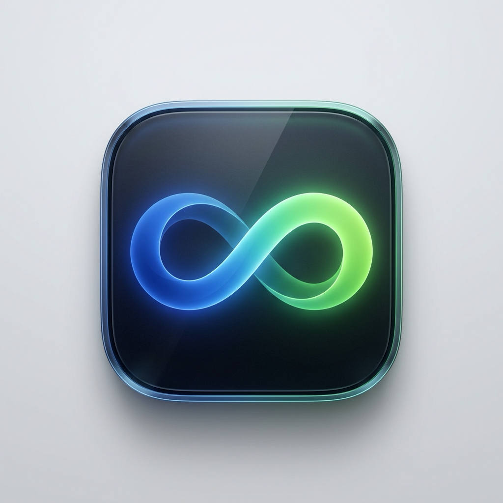

<div align="center">
  
  <h1 align="center" style="margin-top: 12px; margin-bottom: 0;">Aether</h1>
  <p align="center"><b>The invisible bridge between your Mac and Android.</b></p>
  <p align="center">
    <a href="LICENSE"></a>
    
    
    
  </p>
</div>

---

**Aether** is a peer-to-peer continuity suite bringing Apple Sequoia-grade **iPhone Mirroring** and **Continuity** features to Android and macOS.

Enjoy **60 FPS Metal-accelerated screen mirroring**, **invisible bidirectional Universal Clipboard**, **AirDrop-style file drops**, and **live cross-device hardware telemetry**—with zero cloud dependencies and zero subscriptions.

---

## ✨ Key Features

- **⚡ 60 FPS Metal-Accelerated Screen Mirroring**: Ultra-low latency video streaming powered by Apple VideoToolbox hardware decoding and Metal rendering (`scrcpy` backend). Seamless keyboard navigation, scroll gestures, and navigation bar controls (Back, Home, App Switcher).
- **📋 Universal Bidirectional Clipboard**: Copy on macOS (`Cmd+C`) and paste immediately on Android. Copy on Android and paste on Mac (`Cmd+V`). Features cryptographic content hashing and timestamp arbitration to prevent feedback loops.
- **📲 AirDrop-Style File Transfers**:
  - **Mac ➔ Phone**: Drop any photo, document, or APK into the Aether window. Files are saved directly to `/sdcard/Download/` and `/sdcard/Pictures/`, automatically indexed into the Android Gallery via `MediaScannerConnection`, and trigger a heads-up notification.
  - **Phone ➔ Mac**: Tap "Send File to Mac" from the Aether Android app. Files land directly in `~/Downloads` on your Mac with native macOS banners and chime sounds.
- **📊 Real-Time Cross-Device Telemetry**: View live battery percentage, charging state, OS versions, storage usage, and local network IPs across both devices.
- **🔒 100% Local & Private**: All communication flows strictly over your local Wi-Fi network and ADB TCP/IP sockets. No servers, no accounts, and no third-party data tracking.

---

## 🏗️ Architecture

```
                 +-----------------------------------------------+
                 |                   MacBook                     |
                 |                                               |
                 |   +-------------------+  +----------------+   |
                 |   |    Aether.app     |  | 60 FPS scrcpy  |   |
                 |   |  (WebKit/AppKit)  |  | (VideoToolbox) |   |
                 |   +---------+---------+  +--------+-------+   |
                 |             |                     |           |
                 |   +---------v---------------------v-------+   |
                 |   |           mac_bridge.mjs              |   |
                 |   |        (Local Bridge :8898)           |   |
                 +---+-------------------+-------------------+---+
                                         |
                       Local Wi-Fi Network (TCP/IP)
                                         |
                 +---+-------------------v-------------------+---+
                 |   |       ContinuityService.java          |   |
                 |   |    (Android Foreground Service :8899) |   |
                 |   +-------------------+-------------------+   |
                 |                       |                       |
                 |         +-------------v---------------+       |
                 |         |       Aether Android        |       |
                 |         |    (Native Companion App)   |       |
                 |         +-----------------------------+       |
                 |                    Android                    |
                 +-----------------------------------------------+
```

---

## 📋 Prerequisites

### 1. macOS (Host)
- macOS 13 Ventura, 14 Sonoma, or 15 Sequoia
- Node.js 18+ (`brew install node`)
- ADB & scrcpy:
  ```bash
  brew install scrcpy android-platform-tools
  ```

### 2. Android Device
- Android 8.0 (Oreo) through Android 15
- **Developer Options** enabled:
  - Go to **Settings** ➔ **About Phone** ➔ Tap **Build Number** 7 times.
  - In **Developer Options**, enable **USB Debugging** (and **Wireless Debugging** if connecting over Wi-Fi).

---

## 🚀 Quick Start Guide

### Step 1: Connect Your Android Device

**Option A — Wireless ADB (Recommended):**
1. Ensure your Mac and Android phone are on the same Wi-Fi network.
2. In Android **Developer Options** ➔ **Wireless Debugging**, tap **Pair device with pairing code**.
3. Run on your Mac:
   ```bash
   adb pair <ip>:<port> <pairing-code>
   adb connect <ip>:<port>
   ```

**Option B — USB Cable:**
Simply plug in your phone via USB and tap **Always Allow** on the authorization prompt.

---

### Step 2: Install & Start Aether on Android

Build and install the lightweight native Android app:

```bash
cd android-app
./build.sh
adb install -r ContinuityCompanion.apk
```

Open **Aether** on your phone. It runs a lightweight background foreground service (`:8899`) with a persistent status notification.

> **Note**: Tap the bridge IP row in the app if you want to manually configure your Mac's IP, or let it auto-discover the Mac IP on the first ping.

---

### Step 3: Launch Aether on Mac

1. **Start the Aether Bridge**:
   ```bash
   node mac_bridge.mjs
   ```
   *The bridge automatically detects your connected Android device, scans local network interfaces, and initializes the clipboard sync engine.*

2. **Open the Native Mac App**:
   ```bash
   ./native-mac-app/build_mac_app.sh
   open "native-mac-app/Aether.app"
   ```

3. **Enjoy seamless continuity**:
   - Tap **Launch Mirror Window** for instant 60 FPS screen control (Left-click to tap, Right-click for Back, Middle-click for Home).
   - Drag & drop files straight onto the Aether window to push them to your phone.
   - Copy text on either device to see it appear instantly on the other.

---

## ⚙️ Environment Variables (Optional)

All components feature zero-config automatic discovery, but you can override parameters via environment variables:

| Variable | Default | Description |
| :--- | :--- | :--- |
| `TARGET` | Auto-detected from `adb devices` | Target device serial or `IP:PORT` |
| `PHONE_IP` | Auto-detected | IP address of the Android phone |
| `MAC_IP` | Auto-detected primary IPv4 | IP address of the Mac host |
| `PORT` | `8898` | Port for the Mac bridge server |
| `ADB_PATH` | Standard paths / Homebrew | Custom path to `adb` binary |
| `SCRCPY_PATH`| Standard paths / Homebrew | Custom path to `scrcpy` binary |

Example:
```bash
TARGET="192.168.1.50:5555" PORT=8898 node mac_bridge.mjs
```

---

## 🛠️ Project Structure

```
mac-android-continuity/
├── assets/
│   ├── logo.png                 # Official Aether high-res icon
│   └── AppIcon.icns             # Multi-resolution macOS icon bundle
├── mac_bridge.mjs               # Core Mac HTTP bridge & clipboard daemon
├── run_mirroring.sh             # 60 FPS VideoToolbox/Metal mirror launcher script
├── native-mac-app/
│   ├── ContinuityHub.swift      # Native Swift AppKit wrapper
│   ├── hub_ui.html              # Apple-styled dark UI dashboard
│   ├── AppIcon.icns             # Embedded app icon bundle
│   └── build_mac_app.sh         # Swift compiler build script
├── android-app/
│   ├── AndroidManifest.xml      # Android permissions & foreground service declarations
│   ├── build.sh                 # Pure aapt2/javac/d8 zero-Gradle build script
│   ├── res/                     # Android native layouts & drawables
│   └── src/com/workzera/continuity/
│       ├── MainActivity.java    # Android companion dashboard UI
│       └── ContinuityService.java # Foreground service (HTTP server & clipboard sync)
├── test_continuity.mjs          # Unit tests & simulation checks
└── test_live_phone.mjs          # End-to-end live hardware tests
```

---

## 🧪 Testing

Run the automated test suite to verify your setup:

```bash
# Verify local bridge endpoints & simulation
node test_continuity.mjs

# Verify live physical device hardware connectivity (requires connected phone)
node test_live_phone.mjs
```

---

## 🤝 Contributing

Contributions are welcome! Please open an issue or submit a pull request for new features, bug fixes, or performance optimizations.

1. Fork the Project
2. Create your Feature Branch (`git checkout -b feature/AmazingFeature`)
3. Commit your Changes (`git commit -m 'Add some AmazingFeature'`)
4. Push to the Branch (`git push origin feature/AmazingFeature`)
5. Open a Pull Request

---

## 📄 License

Distributed under the **MIT License**. See [`LICENSE`](LICENSE) for more information.
